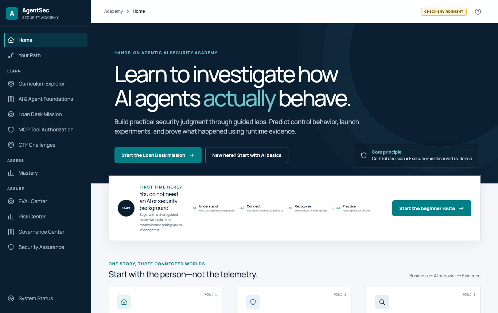
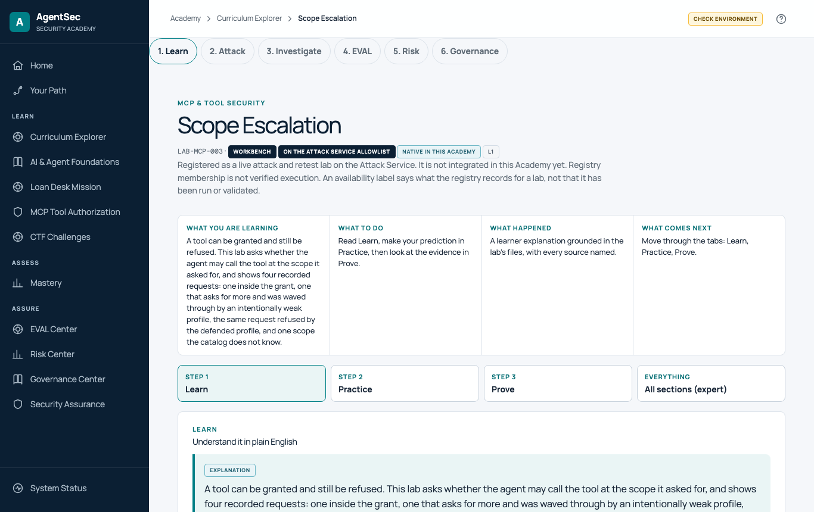
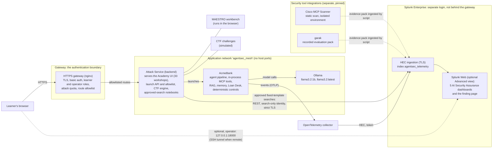

# AgentSecLab

**AgentSecLab: Learn to attack, defend and investigate AI agents—with evidence.**

The workflow every workshop follows: **Attack → Observe → Investigate → Defend → Retest → Explain the Evidence.**

AgentSecLab runs a small, deliberately simple bank assistant, **AcmeBank**, that you attack in controlled experiments and then investigate with real telemetry in Splunk. A browser-based **Academy** guides you through 33 workshops. Thirteen of them run live on your machine; the rest are guided analyses of recorded or simulated evidence, and every page says which. Nothing here is a production system, and all data is synthetic.



> **Status: RC2 (release candidate 2), restricted single-user beta.** Tested on one disposable Ubuntu 24.04 host (details in [Tested and untested](#tested-and-untested)). Read the [limitations](#what-agentseclab-is-not) before you rely on it.

## How it fits with other tools

AgentSecLab is a learning environment. It is meant to sit beside the tools you already use, not replace them:

| Tool family | What it does well | What AgentSecLab adds |
|---|---|---|
| **Scanners** (for example Cisco MCP Scanner) | Find issues in an artifact | A place to see the issue in a running agent and in Splunk; the scanner is integrated, see [Security tools](docs/SECURITY_TOOLS.md) |
| **Red-team frameworks** (for example garak) | Probe a model at scale | A recorded garak result you can read next to the telemetry of the same kind of attack |
| **CTFs** | Practise exploitation | Three simulated challenges, plus the defender's side: what the evidence shows |
| **Governance tools** | Track risk and controls | Evidence that a control did or did not act, and what that does not prove |
| **Commercial platforms** | Monitor and protect production | A safe, local place to practise the investigation steps those platforms support; it does not measure or compare them |

It does not claim to do anything those tools do, and it is not a substitute for them.

## Outcomes by role

| Role | After the workshops you can |
|---|---|
| **SOC analyst, detection engineer** | Rebuild an agent run from Splunk events by `agentsec.run.id`; separate a control decision from an execution; write a search that would have caught an attack; read what an alert's silence means |
| **AI application security engineer** | Show why authorization belongs in deterministic code outside the model; compare tool, scope, resource and argument checks; run the same attack against the vulnerable and the defended profile |
| **Security architect** | Apply CSA MAESTRO's seven layers to one system; find trust boundaries and cross-layer attack paths; produce a risk register with mitigations |
| **GRC practitioner** | See which controls have evidence (verified effective, verified ineffective, finding observed, not tested, insufficient evidence); map findings to guidance without making a compliance claim |
| **Instructor, consultant, solutions engineer** | Run a local, repeatable class or demo with honest labels for live, recorded and simulated evidence |

## Where things are

| Path | What it holds |
|---|---|
| `agentsec`, `scripts/` | The installer command and its helpers |
| `src/agentsec/` | The application: AcmeBank, controls, Attack Service, assurance rules |
| `academy-ui/`, `learning/` | The Academy front end and the 33 workshops' content and specimens |
| `gateway/`, `docker/`, `docker-compose*.yml`, `config/` | The HTTPS gateway, container builds and service configuration |
| `splunk_app/`, `telemetry/` | The Splunk app (searches, dashboards) and the telemetry contract |
| `tools/` | Pinned integrations: Cisco MCP Scanner, garak |
| `tests/` | The test suite |
| `docs/` | Guides, in the table below; `docs/README.md` is the full index |

## The journey, and what is operational

**Academy → Workshop → Attack or Defense → Security tool → Investigate notebook → Security Assurance → Evidence → Retest.** All of it happens in the Academy at one HTTPS address; the Attack Service is only its backend.

| Step | Operational | Needs separate sign-in or setup | Not supported or not tested |
|---|---|---|---|
| Academy, workshops, Attack UI | Yes, behind the gateway | `operator` role to launch | |
| Attack, defend, retest (13 live labs) | Yes | | |
| Security tools | Cisco MCP Scanner (static, isolated) and a recorded garak result | A scanner run is optional | Nemotron evaluation (none exists) |
| Investigation | The Investigate stage is a notebook: you press **Run** and the Attack Service executes an approved, fixed-template search against Splunk, then shows the rows, a chart and a plain-language reading | The installer's search-only Splunk identity (`./agentsec splunk-access`; check with `--check`); if it is missing the notebook says so and fails closed | Validated on one real Splunk 10.2.7 host (bundled Splunk, 2026-10-30) |
| Security Assurance (Academy > Security Assurance, `/learn/assurance`) | Findings with raw evidence, an investigation notebook and a retest comparison | The same search-only identity | Validated on one real Splunk 10.2.7 host (bundled Splunk, 2026-10-30) |
| Splunk Web and the five dashboards | Optional **Advanced** views, never a required step | Splunk login; Splunk Web is **outside the gateway** (host loopback) | Row-click drilldown was not exercised |
| VERIFIED evidence on launch cards, Loan Desk host verifier | Optional and legacy | Splunk REST token and CA; `AGENTSEC_LEGACY_HOST_VERIFIER=1` for the legacy verifier (ignored behind the gateway) | Off by default; no default run is Splunk-VERIFIED |

## Why agentic AI security is different

An agent is an application with a component that *decides what to do next from text*. A language model reads a request, a retrieved document, a memory or a tool result and proposes an action. So untrusted text can steer behaviour, "allowed" has to be decided by something other than the model, authority is delegated and claimed rather than fixed in code, and what happened can only be reconstructed from evidence. A web-application scanner does not model any of that.

AgentSecLab turns those problems into experiments you can run, observe and explain:

- **Prompt injection, goal hijacking, poisoned retrieval and memory**: untrusted text that acts like an instruction.
- **Tool authorization (MCP-style)**: a tool request is not a grant; scope, resources, arguments, tool results and tool catalogs are all attack surface.
- **Identity and delegation**: a claimed authority versus a granted one; the confused deputy.
- **Investigation**: rebuilding a run from Splunk events and saying what the evidence can and cannot prove.
- **Threat modeling**: applying the Cloud Security Alliance's **MAESTRO** seven-layer framework to the same system.

The organising idea, shown on the home page: **a control decision is not an execution, and an execution is not observed evidence.**

## Who it is for and what you learn

| You are | You will learn to |
|---|---|
| **A newcomer** (basic security knowledge, no AI needed) | Recognise how agents fail and read a security decision correctly |
| **A security practitioner or architect** | Decompose an agentic system across seven layers, find trust boundaries and write a risk register with mitigations (CSA MAESTRO) |
| **A SOC analyst or detection engineer** | Reconstruct a run by its `agentsec.run.id`, separate decision from execution from evidence, and judge what an alert's silence means |
| **An AI developer or agent builder** | See why authorization belongs in deterministic code outside the model, and how tool, scope, resource and argument checks differ |
| **A solutions engineer or instructor** | Run a local, repeatable demo or class with honest labels for live versus recorded evidence |

More on the value for each role, with the architecture and the limits: [Benefits, architecture and security guide](docs/BENEFITS_AND_SECURITY_ARCHITECTURE.md).

## What you can do

- **33 workshops** in a guided curriculum (L0 to L10): [workshop catalog](docs/WORKSHOP_CATALOG.md).
- **Run the same attack three times**, BASELINE, ATTACK (an intentionally vulnerable profile) and RETEST (the defended profile), and see the outcome change because the server changed the profile.
- **The AcmeBank Loan Desk**: a mission with a real local language model (`llama3.2:latest`) whose every action passes a deterministic policy engine.
- **Three CTF challenges** (simulated, server-verified, scored once each).
- **Investigate in the Academy**: every live run emits events under one run id into a Splunk index, and the Investigate notebook runs approved, fixed-template searches on it and shows rows, a chart and a plain-language reading. Dashboards and hunt searches in Splunk Web are an optional Advanced view.
- **CSA MAESTRO threat modeling**: a seven-layer workbench with cross-layer attack paths, a qualitative risk register, mitigations, a self-check and a downloadable report.
- **Evaluate, assess risk and map governance** in the EVAL, Risk and Governance centers (recorded evidence and browser-local drafts).



## Live, recorded and simulated: what actually runs

| Kind | Count | What runs | Example |
|---|---|---|---|
| **LIVE** | 13 | You launch BASELINE, ATTACK and RETEST. Events land in Splunk. Some launches call the local Ollama model; the MCP launches use an in-process MCP model and no language model; the Loan Desk uses a real model | LAB-PI-001, the MCP workshops, RAG, memory, goal integrity, delegation, Loan Desk |
| **RECORDED** | 8 | Nothing runs. You analyse evidence the lab captured earlier and committed | LAB-SCANNER-RUNTIME-EVIDENCE, LAB-BLUE-TEAM-INCIDENT-001 |
| **SIMULATED packet** | 11 | Nothing runs. You analyse a committed, labelled simulated packet; it enforces nothing | LAB-HITL-APPROVAL, LAB-THREAT-MODELING-001 (with its browser-only workbench) |
| **Orientation** | 1 | A reading page | L0 |

The three CTF challenges are separate from the 33 and are **simulated** with a scripted agent. **Not every workshop is a live LLM exercise; 20 of 33 run no agent at all.**

## Terms used below

| Term | Meaning |
|---|---|
| **Run id** | The UUID of one run; every event of that run carries it as `agentsec.run.id` |
| **MCP** | Model Context Protocol: how an agent calls tools. Here it is an in-process model of its semantics |
| **RAG** | Retrieval-augmented generation: the agent pulls documents into its prompt |
| **ALLOW / DENY / OBSERVE** | A control permitted the action, refused it, or only recorded and classified it |
| **OpenTelemetry (OTel), HEC** | How events leave AcmeBank and enter Splunk: the OTel collector sends them to Splunk's HTTP Event Collector |
| **BASELINE / ATTACK / RETEST** | The same request run with the defended profile, the intentionally vulnerable profile, and the defended profile again |

## Architecture



The language model **proposes**; deterministic code **authorizes and executes**; Splunk **observes** and enforces nothing. The browser cannot send a payload, a tool name, a search or a security profile: the Attack Service chooses them. Only the gateway is meant to be reachable from outside the host. In gateway mode AcmeBank and Ollama publish no host port, and Splunk Web, HEC and the collector bind to loopback only. The [Visual guide](docs/VISUAL_GUIDE.md) adds the data-flow and trust-boundary diagrams and five more (workflow, attack sequence, Splunk investigation, MAESTRO layers, learner journey); each says what is optional.

## Evidence-driven assurance dashboards

The Academy's Security Assurance page (`/learn/assurance`) shows findings with raw evidence, an investigation notebook and a retest comparison; the same five Splunk dashboards and finding page are an optional Advanced view. Together they turn what happened in a run into a finding you can read and retest, with one of six statuses: Verified effective, Verified ineffective, Finding observed, Not tested, Insufficient evidence, Verification unavailable. Missing telemetry never reads as a pass, and an intentionally vulnerable profile is labelled *by design*, not as a failed control. On the acceptance host all 34 searches ran and 118 findings matched a Python reference implementation of the same rules (the screenshot below shows a different time range and run count). They make no organizational compliance claim. Guide, with the rules: [AI Security Assurance](docs/AI_SECURITY_ASSURANCE.md).


## Quick start (Ubuntu 24.04, Docker)

`git clone` follows the default branch, `main`, which is RC2. This is the path the acceptance runs tested. You need Docker Engine with Compose v2 (your user in the `docker` group), `git`, `python3`, `openssl` and `curl`. **Do not use `sudo` for the lab commands.**

```bash
git clone https://github.com/machowdhury/AgentSecLab.git
cd AgentSecLab

./agentsec preflight                                    # read-only checks of this machine
./agentsec --non-interactive --set gateway.ctf=true --accept-warnings all --dry-run plan   # show what will happen; starts nothing
./agentsec --non-interactive --set gateway.ctf=true --accept-warnings all --apply install  # about 9 to 10 minutes on the tested host
./agentsec status                                       # expect: OK project 'agentsec': all services are up.
cat .gateway/credentials.txt                            # the learner and operator passwords
```
Then open **`https://localhost/learn`**. Your browser will warn until you trust the lab's own certificate authority, `.gateway/tls/ca.pem` (import steps: [installation guide, 2.7](docs/INSTALLATION_AND_DEPLOYMENT.md#27-open-the-academy-tested-through-an-ssh-tunnel-the-same-requests-run-directly-on-the-host-were-not-run)). Sign in as `learner` (passwords: `cat .gateway/credentials.txt`) and start with **Start the beginner route**. Sign in as `operator` to launch attacks. You investigate inside the Academy. Splunk Web is an optional Advanced view at `http://localhost:18000` on the same machine (user `admin`, password `SPLUNK_PASSWORD` in `.env`); no step needs it. Stop with `./agentsec down` (keeps your data) and restart with `./agentsec up`.

The full guide, with expected output, EC2 settings, certificates, SSH tunnelling, Splunk and troubleshooting, is the [Installation and deployment guide](docs/INSTALLATION_AND_DEPLOYMENT.md). **Measured on the tested host, not requirements:** about 25 GiB disk after install, about 6 GiB peak RAM during a Loan Desk run with both models loaded, and about 9 to 10 minutes for a clean install.

## Workshop catalog at a glance

The full catalog (33 entries with objectives, mode, how to start, expected outcomes, Splunk evidence, completion and reset) is [docs/WORKSHOP_CATALOG.md](docs/WORKSHOP_CATALOG.md).

| Level | Theme | Workshops | LIVE / recorded / simulated |
|---|---|---|---|
| L0 | Orientation | 1 | reading |
| L1 | Input and tool authority | 5: Direct Prompt Injection, Tool Authorization, Scope Escalation, Parameter / Resource Authorization, Loan Desk | 5 / 0 / 0 |
| L2 | Context and evidence are data | 6: RAG, Persistent Memory, Tool Result Trust, Tool Catalog, Scanner + Runtime Evidence, External Security Toolbox | 4 / 2 / 0 |
| L3 | Intent and identity | 3: Goal / Instruction Integrity, Agent Identity / Delegation, Confused Deputy | 3 / 0 / 0 |
| L5 | Integrated purple team | 2: Lending Assistant Investigation, Splunk Defender Bridge | 1 / 1 / 0 |
| L6 | Blue-team investigation | 2: Blue-Team Incident, Detection Engineering | 0 / 2 / 0 |
| L7 | Threat modeling and architecture | 5: CSA MAESTRO Threat Modeling, Agent Identity and NHI, A2A Authentication, Human Approval, Credential Lifetime | 0 / 1 / 4 |
| L8 | Privacy and data governance | 7: Privacy Incident, RAG Purpose, Memory Isolation, Asset Inventory, Component Provenance, Code Agent Bounds, Change Bounds | 0 / 0 / 7 |
| L9 | Multi-stage incident | 1 | 0 / 1 / 0 |
| L10 | Advanced capstone and mastery | 1 | 0 / 1 / 0 |

## Tested and untested

The acceptance logs behind this section are not published; what follows is their summary. Tested on one disposable AWS host (`m6i.2xlarge`, Ubuntu 24.04 x86-64 with the 6.8 kernel pinned, Docker Engine, gateway on port 443, generated test certificate), in three acceptance runs: clean host, final, final two checks. They cover the installer, HTTPS verification, authentication roles, all 36 allowlisted live launches (12 labs, each BASELINE, ATTACK and RETEST; the Loan Desk is a separate mission), real events in Splunk, three CTF challenges with scoring and reset, persistence across restart, a real Loan Desk transaction, the MAESTRO workflow and clean teardown.

**Not tested:** macOS and Windows for RC2, other Linux distributions and ARM, rootless Docker and Podman, an organization-managed certificate, a non-loopback deployment, the gateway on port 8000, and an external Splunk Enterprise or Splunk Cloud against a real service.

## What AgentSecLab is not

- **Not production software, and not for the public internet.** It contains intentionally vulnerable profiles. Authentication is a stand-in (basic authentication, two roles, no SSO, no login throttling), for one local participant.
- **Not a measurement of any real model or product.** A recorded run is one run, not a rate. No compliance or certification claim is made.
- **Not real MCP or A2A transport.** Those are in-process models; the CTF uses a scripted agent.
- **Splunk REST verification (VERIFIED) is not on by default.** It needs a matching management certificate, a trusted CA and a token; without them the Academy shows VERIFICATION UNAVAILABLE. The Investigate notebook and Security Assurance use the installer's separate search-only identity instead; where it is not provisioned they say so and fail closed. That path was validated on one real Splunk 10.2.7 host (bundled Splunk, 2026-10-30); it was not validated against an external Splunk, Splunk Cloud or an organization certificate. The bundled Splunk's KV store (needed for tokens) does not start on a Linux kernel 6.19 or newer, such as the 7.0 kernel in current Ubuntu 24.04 AWS images.
- **Not everything sits behind one address.** Splunk Web (an optional Advanced view) and the real AcmeBank are not routed through the gateway; learners need neither.
- **Scope of the beta.** Restricted, single-user, tested on one Ubuntu 24.04 host. Windows, macOS and other untested paths are listed above.
- **Dashboards.** The row-click drilldown was not exercised. A run that never reaches Splunk cannot appear as a finding (the Academy reports VERIFICATION UNAVAILABLE). Time to detection is unavailable. The Loan Desk is not scored. Some scanner and model evidence comes from committed packs, not fresh scans. Nemotron has not been tested.
- **Operations.** Backup, upgrade, multi-user and incident-response procedures were not tested.
- **MAESTRO:** the lab implements the CSA MAESTRO v1 framework as a workbench. It does **not** run CSA's MAESTRO Threat Analyzer and does not implement MAESTRO v2.
- **Models:** two small local Llama models; results vary with the model, the Ollama version and sampling.

## Older material

The earlier multi-port, plain-HTTP flow that release v1.2.0 used is kept for reference in [docs/LEGACY_MULTI_PORT_FLOW.md](docs/LEGACY_MULTI_PORT_FLOW.md). Everything on this page describes RC2. Do not mix the two flows on one machine.

For preflight and startup details see [docs/QUICKSTART.md](docs/QUICKSTART.md); for failures see [docs/TROUBLESHOOTING.md](docs/TROUBLESHOOTING.md).

## Documentation

| Read this | When |
|---|---|
| [Installation and deployment](docs/INSTALLATION_AND_DEPLOYMENT.md) | Installing, configuring, operating and recovering the lab |
| [Learner guide](docs/LEARNER_GUIDE.md) | Using the Academy, workshops, Attack UI, Splunk, CTF and MAESTRO, plus a ten-stage practitioner learning path and an evidence template |
| [Workshop catalog](docs/WORKSHOP_CATALOG.md) | All 33 workshops |
| [Benefits, architecture and security](docs/BENEFITS_AND_SECURITY_ARCHITECTURE.md) | Why it matters, trust boundaries, what is and is not claimed |
| [Visual guide](docs/VISUAL_GUIDE.md) | Diagrams and screenshots |
| [AI Security Assurance](docs/AI_SECURITY_ASSURANCE.md) | The dashboards, statuses, rules and how to read a finding |
| [Security tools](docs/SECURITY_TOOLS.md) | Integrated tools: version, licence, install method, use, status, limits |
| [Third-party notices](THIRD_PARTY_NOTICES.md) | Licences of what this project uses |
| [Documentation index](docs/README.md) | Everything else: instructor guide, Splunk integration, gateway, CTF, installer reference |

## Contributing and license

See [CONTRIBUTING.md](CONTRIBUTING.md). Licensed under the Apache License 2.0; see [LICENSE](LICENSE).
