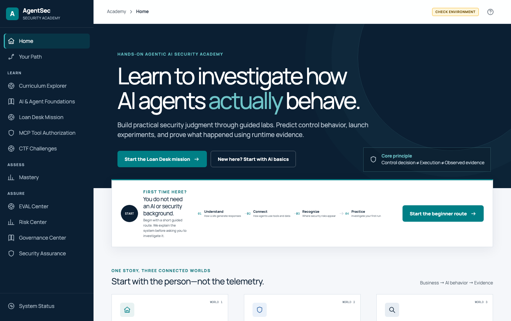
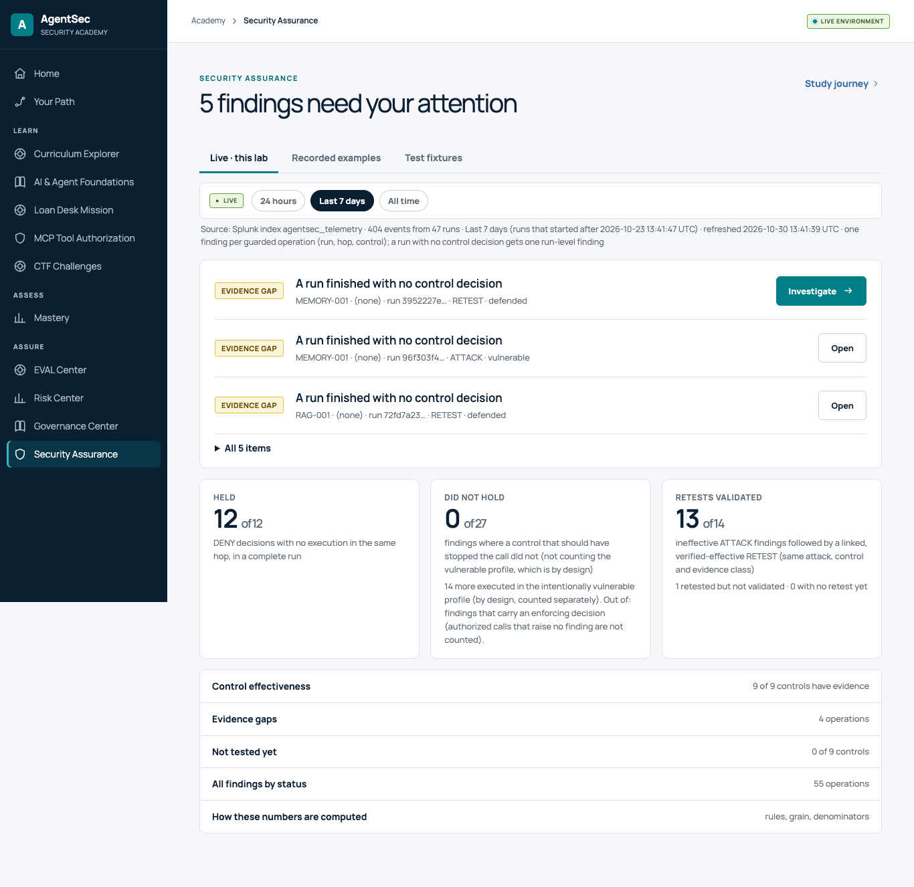
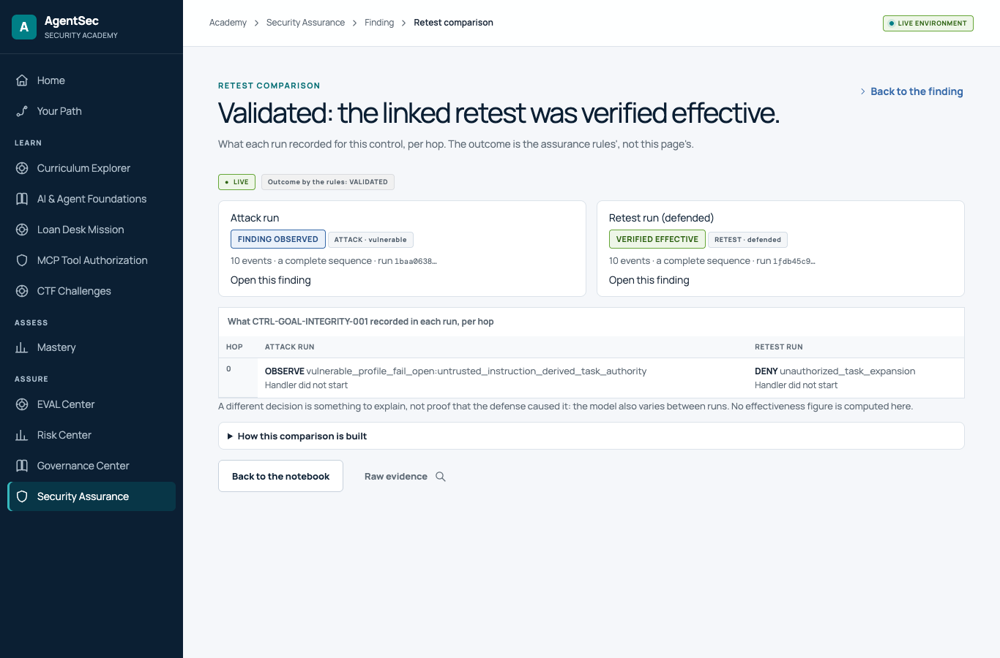
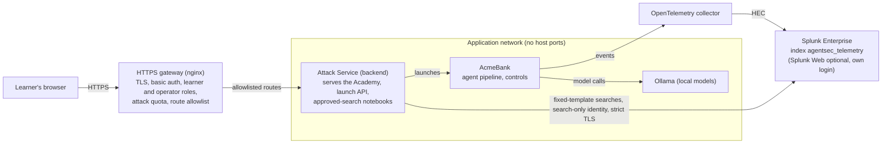

# AgentSecLab

**A hands-on learning environment for understanding, attacking, investigating and defending agentic AI systems.**

You run a small, deliberately simple bank assistant (**AcmeBank**) on your own machine, attack it in controlled experiments, and then investigate what actually happened using real telemetry. A browser-based **Academy** guides you through **33 workshops**. Thirteen of them run live; the rest are guided analyses of recorded or simulated evidence, and every page says which. Nothing here is a production system, and all data is synthetic.

<p align="center">
  
</p>

> **Status: RC2 (release candidate 2), a restricted single-user beta.** Verified on one platform: Ubuntu 24.04 x86-64 with Docker Engine. See [Compatibility and limits](#compatibility-and-limits) before you rely on it.

**Jump to:** [Install: LOCAL or REMOTE](#quick-start) · [The learning journey](#the-learning-journey) · [What actually runs](#what-actually-runs) · [Documentation](#documentation) · [Limits](#compatibility-and-limits)

## Why use it

An agent is an application with a component that *decides what to do next from text*. So untrusted text can steer behaviour, "allowed" must be decided by something other than the model, and what happened can only be reconstructed from evidence. AgentSecLab turns those problems into experiments you can run, observe and explain. Its organising idea, shown on the home page:

> **A control decision is not an execution, and an execution is not observed evidence.**

You will practise: prompt injection and goal hijacking, poisoned retrieval and memory, MCP-style tool authorization, identity and delegation (the confused deputy), investigating a run from Splunk events, and threat modeling with the Cloud Security Alliance's MAESTRO seven-layer framework.

| You are | You will learn to |
|---|---|
| **A beginner** (basic security knowledge, no AI needed) | Recognise how agents fail and read a security decision correctly |
| **A security practitioner or architect** | Find trust boundaries, decompose a system across seven layers and write a risk register |
| **A SOC analyst or detection engineer** | Rebuild a run by its `agentsec.run.id`, separate decision from execution from evidence, and judge what an alert's silence means |
| **An AI developer or agent builder** | See why authorization belongs in deterministic code outside the model |
| **A solutions engineer or instructor** | Run a repeatable local class or demo with honest labels for live, recorded and simulated evidence |

## Quick start

Two paths. Both use the same installer, `./agentsec`. The full steps, certificate trust and troubleshooting are in the **[installation guide](docs/INSTALLATION_AND_DEPLOYMENT.md)**.

**Verified platform: Ubuntu 24.04 x86-64 with Docker Engine.** macOS, Windows and other systems have **not** been validated, so no support is claimed for them. Run the commands as your normal user (in the `docker` group), **never with `sudo`**. You need `git`, `python3`, `openssl`, `curl`, Docker with Compose v2, about 25 GiB of free disk, and ports 443, 8088, 4317 and 4318 free. `git clone` follows `main`, which is RC2.

**LOCAL: on your own Ubuntu computer** (loopback only)
```bash
git clone https://github.com/machowdhury/AgentSecLab.git && cd AgentSecLab
./agentsec preflight
./agentsec --non-interactive --set gateway.ctf=true --accept-warnings all --apply install   # about 10 minutes
./agentsec status                                       # expect: OK project 'agentsec': all services are up.
cat .gateway/credentials.txt                            # the learner and operator passwords
```
Trust `.gateway/tls/ca.pem` in your browser ([how](docs/INSTALLATION_AND_DEPLOYMENT.md#local-install-on-your-own-computer), step 4), then open **https://localhost/learn**.

**REMOTE: on an Ubuntu server or cloud VM, opened directly from your laptop (no SSH tunnel).** You need a DNS name for the server and a firewall or cloud security group that allows HTTPS **only from your own IP** (never `0.0.0.0/0`). On the server, run the same commands with this install line:
```bash
./agentsec --non-interactive --ack-external-controls --accept-warnings all --set deployment=organization \
  --set gateway.bind=0.0.0.0 --set gateway.host=lab.example.com --set gateway.ctf=true --apply install
```
Copy `.gateway/tls/ca.pem` to your laptop, trust it, and open **https://lab.example.com/learn**. Only the gateway's HTTPS port is published; Splunk, HEC and Ollama stay internal. Details, and why the acknowledgement is required: [the guide](docs/INSTALLATION_AND_DEPLOYMENT.md#remote-ubuntu-server-or-cloud-vm-open-it-directly-from-your-laptop).

Sign in as `operator` to launch attacks, `learner` to read. Stop with `./agentsec down` (keeps your data); restart with `./agentsec up`.

## The learning journey

Every live workshop follows the same eight stages, shown as a rail on the workshop page:

| Stage | What you do, and why |
|---|---|
| **1. Learn** | Read the concept in plain language, so the experiment has a question |
| **2. Predict** | Lock in what you expect the control to do *before* anything runs |
| **3. Baseline** | Run the normal request against the defended profile, to see what "normal" looks like |
| **4. Attack** | Run the same request against an intentionally vulnerable profile |
| **5. Investigate** | Press **Run** in a notebook: the Attack Service runs an approved, fixed-template search against Splunk and shows the rows, a chart and a plain-language reading |
| **6. Defend** | See what the defended profile changes |
| **7. Retest** | Run the defended profile again and compare it with the attack |
| **8. Explain evidence** | Write down what the evidence shows and, as important, what it does not prove |

You are reading the lab's actual security decisions, executions and events, not a description of them. The Loan Desk mission shows seven mission stages on the same rail. Recorded and simulated workshops launch nothing and have no rail: you analyse committed evidence, and the page says so.

## See it

<table>
  <tr>
    <td width="50%"><a href="docs/images/academy-assurance-overview.png"></a><br><sub><b>Security Assurance overview.</b> Findings, counts as <i>n of N</i>, and the evidence class and source stated on every view.</sub></td>
    <td width="50%"><a href="docs/images/academy-assurance-compare.png"></a><br><sub><b>Retest comparison.</b> The attack and the defended retest side by side, per hop: OBSERVE became DENY.</sub></td>
  </tr>
</table>

More: the Investigate notebook ([`docs/images/academy-assurance-notebook.png`](docs/images/academy-assurance-notebook.png)), a finding ([`academy-assurance-finding.png`](docs/images/academy-assurance-finding.png)), the Loan Desk, CTF and MAESTRO workbench are all in the [Visual guide](docs/VISUAL_GUIDE.md). The notebook screenshot shows a run's SPL exactly as the Academy builds it; learners cannot edit it. *The Visual guide's older workshop-page screenshot predates the eight-stage rail and is not used here.*

## What actually runs

| Kind | Count | What runs |
|---|---|---|
| **LIVE** | 13 | You launch BASELINE, ATTACK and RETEST. Events land in Splunk, one set per run id. Some launches call a local Ollama model; the MCP launches use an in-process MCP model and no language model; the Loan Desk uses a real model (`llama3.2:latest`) behind a deterministic policy engine |
| **RECORDED** | 8 | Nothing runs. You analyse evidence the lab captured earlier and committed |
| **SIMULATED** | 11 | Nothing runs. You analyse a committed, labelled simulated packet; it enforces nothing (for example `LAB-HITL-APPROVAL`) |
| **Orientation** | 1 | A reading page |

**Not every workshop is a live LLM exercise; 20 of 33 run no agent at all.** Some exercises use real local models (two small Llama models, so results vary with the model and sampling); others model agent and tool behaviour deterministically. The three CTF challenges are separate from the 33 and use a scripted agent. Recounted from the catalog and registry: 33 = 13 + 8 + 11 + 1. Full list with objectives and how to start each: [workshop catalog](docs/WORKSHOP_CATALOG.md).

| Level | Theme | LIVE / recorded / simulated |
|---|---|---|
| L0 | Orientation | reading |
| L1 | Input and tool authority (prompt injection, tool authorization, scope escalation, parameter authorization, Loan Desk) | 5 / 0 / 0 |
| L2 | Context and evidence are data (RAG, memory, tool results, tool catalog, scanner and external tools) | 4 / 2 / 0 |
| L3 | Intent and identity (goal integrity, delegation, confused deputy) | 3 / 0 / 0 |
| L5 | Integrated purple team | 1 / 1 / 0 |
| L6 | Blue-team investigation | 0 / 2 / 0 |
| L7 | Threat modeling and architecture (MAESTRO, identity, A2A, human approval, credentials) | 0 / 1 / 4 |
| L8 | Privacy and data governance | 0 / 0 / 7 |
| L9, L10 | Multi-stage incident; advanced capstone | 0 / 2 / 0 |

## How to investigate the results

You investigate **inside the Academy**. Open a workshop's Investigate stage, or **Security Assurance** (`/learn/assurance`), which turns a run into a finding with raw evidence, an investigation notebook and a retest comparison. A finding has one of six statuses: Verified effective, Verified ineffective, Finding observed, Not tested, Insufficient evidence, Verification unavailable. Missing telemetry never reads as a pass, and an intentionally vulnerable profile is labelled *by design*. No compliance claim is made. Rules and semantics: [AI Security Assurance](docs/AI_SECURITY_ASSURANCE.md).

Splunk Web and its dashboards are an **optional advanced view** on the server's loopback, behind their own login; no step needs them.

## Technology and architecture

React Academy, a Python Attack Service (the backend), AcmeBank (the agent under test), Ollama for local models, OpenTelemetry into Splunk Enterprise, and an nginx HTTPS gateway as the only entry point. The model **proposes**; deterministic code **authorizes and executes**; Splunk **observes** and enforces nothing. The browser cannot send a payload, a tool name, a search or a security profile: the Attack Service chooses them.

<details>
<summary>Architecture diagram</summary>


</details>

Only the gateway is meant to be reachable from outside the host. The [Visual guide](docs/VISUAL_GUIDE.md) has the data-flow and trust-boundary diagrams.

## Documentation

Organised by what you need to do.

| | Guides |
|---|---|
| **Tutorials** (learn by doing) | [Learner guide](docs/LEARNER_GUIDE.md): first login, first workshop, a ten-stage practitioner path · [AI Security Assurance](docs/AI_SECURITY_ASSURANCE.md): your first finding |
| **How-to guides** | [Install LOCAL or REMOTE](docs/INSTALLATION_AND_DEPLOYMENT.md) · [Launch an attack, read a decision, investigate a run, compare baseline and retest](docs/LEARNER_GUIDE.md) · [Troubleshooting](docs/TROUBLESHOOTING.md) · [Instructor guide](docs/INSTRUCTOR_GUIDE.md) |
| **Reference** | [Workshop catalog](docs/WORKSHOP_CATALOG.md) · [Installer configuration](docs/INSTALLER.md) · [Gateway, TLS and authentication](docs/GATEWAY.md) · [Splunk integration](docs/SPLUNK_INTEGRATION.md) · [Security tools](docs/SECURITY_TOOLS.md) · [Assurance statuses and rules](docs/AI_SECURITY_ASSURANCE.md) |
| **Explanation** | [Benefits, trust boundaries and architecture](docs/BENEFITS_AND_SECURITY_ARCHITECTURE.md) · [Visual guide](docs/VISUAL_GUIDE.md) · [Live, recorded and simulated evidence](docs/LIVE_VS_REPLAY.md) |

Everything else: [documentation index](docs/README.md). Licences of what this project uses: [third-party notices](THIRD_PARTY_NOTICES.md).

## Compatibility and limits

- **Tested on one platform:** one disposable Ubuntu 24.04 x86-64 cloud host with Docker Engine, over several acceptance runs (installer, HTTPS verification, roles, all 36 allowlisted live launches, real Splunk events, the notebook and Security Assurance, CTF scoring, restart persistence), plus a direct-HTTPS REMOTE install on one more such host. **Not tested:** macOS and Windows, other Linux distributions, ARM, rootless Docker, Podman, an organization-managed certificate, REMOTE on port 8000, and an external Splunk Enterprise or Splunk Cloud. macOS qualification has not been done.
- **Splunk:** the bundled Splunk Enterprise was validated at 10.2.7. Its KV store does not start on a Linux kernel 6.19 or newer (the current Ubuntu AWS images ship 7.0): see the [kernel note](docs/SPLUNK_INTEGRATION.md#kernel-619-or-newer-and-the-bundled-splunk).
- **Not production software, and never for the open internet.** It contains intentionally vulnerable profiles. Authentication is a stand-in (basic auth, two roles, no SSO, no login throttling) for one participant. REMOTE requires that you restrict network access.
- **No measurement or certification.** A recorded run is one run, not a rate. No compliance, certification or production-readiness claim is made.
- **Models are small and local.** Results vary with the model, Ollama version and sampling. MCP and A2A are in-process models, not real transport. The MAESTRO workbench implements CSA MAESTRO v1; it does **not** run CSA's MAESTRO Threat Analyzer and does not implement MAESTRO v2.
- **Not everything is behind one address.** Splunk Web is outside the gateway. Backup, upgrade, multi-user and incident-response procedures were not tested.

## Contributing and license

See [CONTRIBUTING.md](CONTRIBUTING.md). Licensed under the Apache License 2.0; see [LICENSE](LICENSE). The earlier multi-port flow of release v1.2.0 is kept for reference in [docs/LEGACY_MULTI_PORT_FLOW.md](docs/LEGACY_MULTI_PORT_FLOW.md); do not mix the two on one machine.
