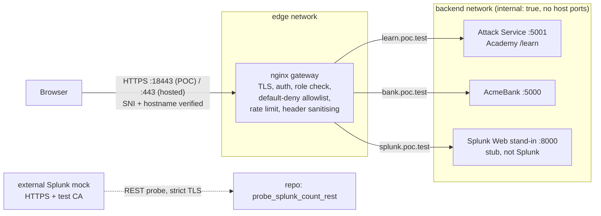

# Gateway POC architecture (Milestone 1)

Only the gateway publishes a port (`127.0.0.1:18443`). Backends, the Splunk stand-in and everything else exist only on an internal Docker network. Ollama, HEC, OTel and Splunk management are not present at all in this POC.

## Decisions the tests support
| Decision | Evidence |
|---|---|
| nginx stays the gateway | The existing PoC already proved TLS, allowlisting and rate limiting; this milestone added auth_request role checks, SNI default-reject, header sanitising and cookie flags with stock nginx 1.27, no extra proxy |
| Host-based routing (no sub-paths) | `learn.`, `bank.`, `splunk.` hostnames; the Splunk route works only as a whole-host proxy (stub) |
| Roles from the authenticated user only | `$role` is derived from `$remote_user`; client-supplied identity headers are overwritten (T14) |
| Authorization via `auth_request` | Runs after authentication: anonymous 401, learner 403 (T11, T12) |
| Strict TLS in every test | Every client call uses `--cacert`/`openssl -verify_return_error`; no `-k`, no `verify=False` |

## Defects the POC found in its own first draft (fixed, kept as regression tests)
1. **Identity-header leak.** `proxy_set_header` is not inherited into a block that sets its own. The Splunk host did not re-declare it, so a client-sent `X-Auth-Role: operator` reached the backend. Fix: one `identity-headers.conf` included in every proxied block (T14).
2. **Authorization ran before authentication.** An `if` + `return 403` executes in the rewrite phase, so anonymous requests got 403 instead of 401. Fix: `auth_request` (T11, T12).
3. **Container port leaked into redirects.** `return 302 /learn` and absolute backend redirects carried `:8443` (the container port) while the browser used `:18443`. Fix: `absolute_redirect off` and `proxy_redirect ... https://$http_host/` (T04, T17).
4. **Config edits need a reload.** The bind-mounted config is not picked up by `compose up`; `run_poc.sh up` now reloads.
5. **Rate limiting precedes authentication.** `limit_req` runs before the access phase, so unauthenticated floods also consume the bucket (and get 429, not 401). Acceptable for abuse protection; noted for the design.

## Not covered (see EVIDENCE.md)
Real Splunk Web, enterprise SSO, EDGE_TERMINATED mode, WebSockets, CSP, production RBAC/OIDC, real external Splunk Enterprise or Cloud, the OTel collector's HEC exporter.
