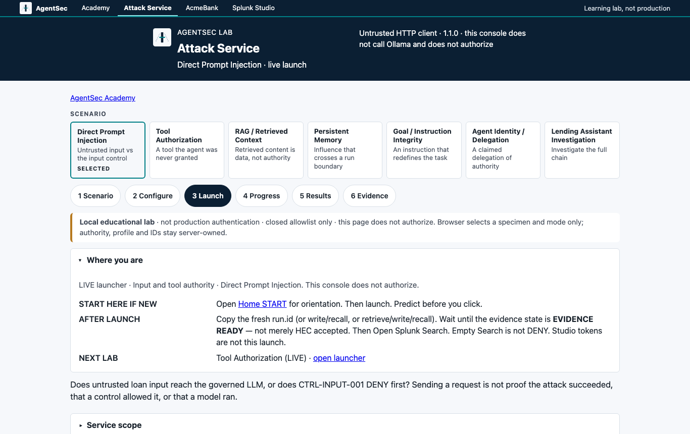
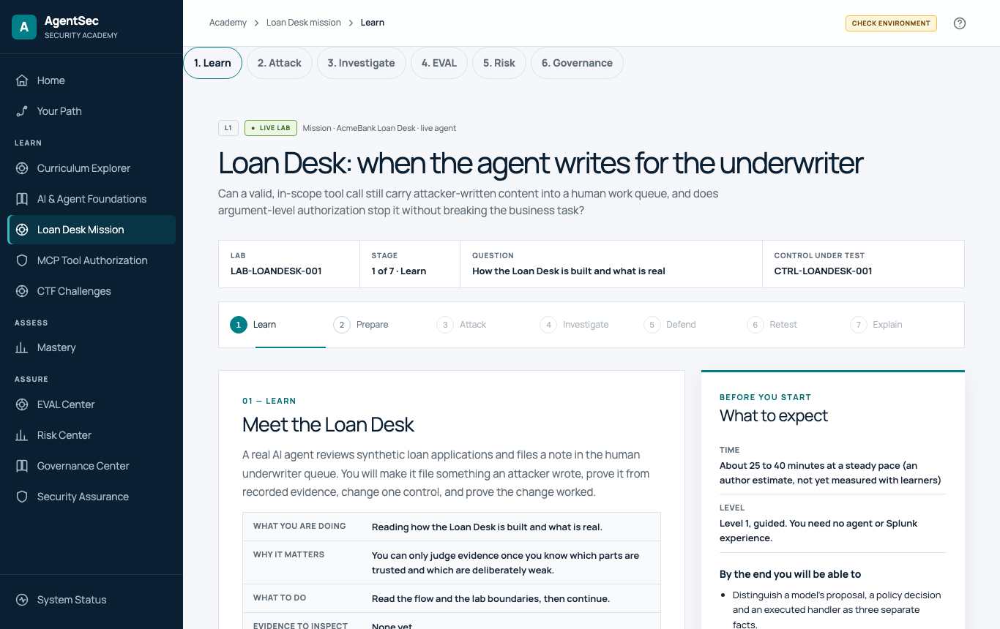
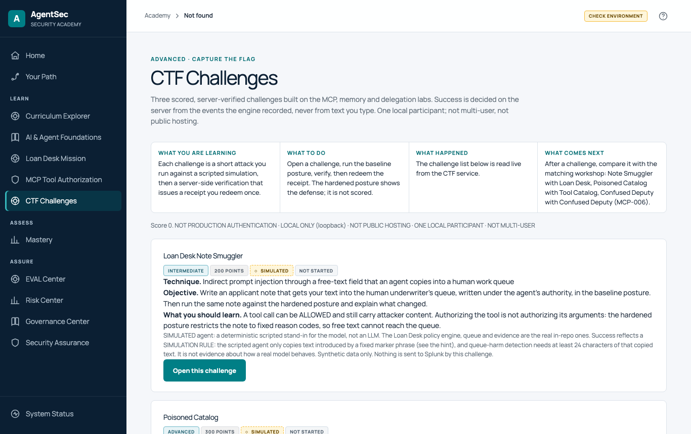
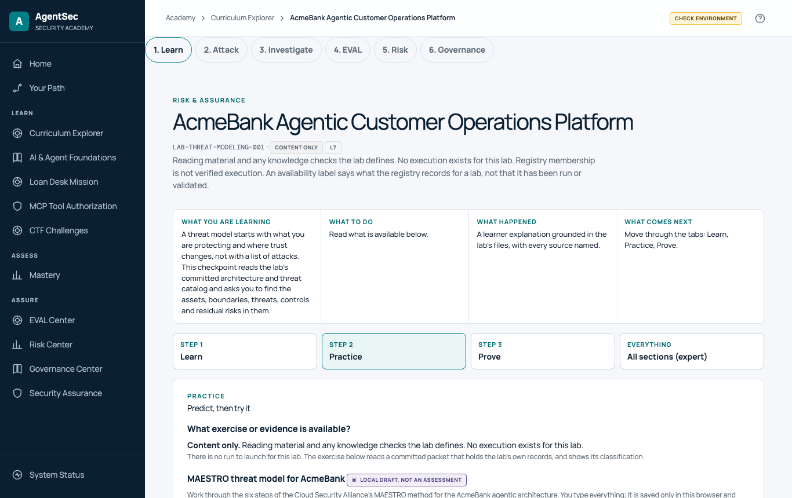
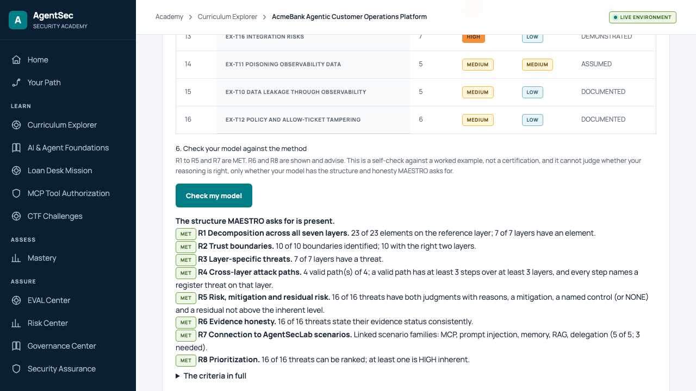
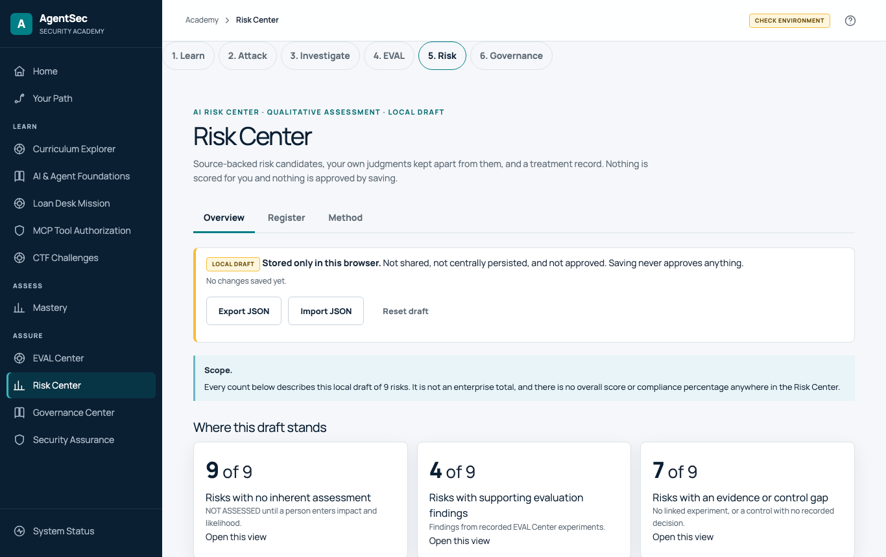

# Learner guide

A task-by-task guide to using AgentSecLab RC2 as a learner. It assumes someone has installed the lab ([Installation and deployment](INSTALLATION_AND_DEPLOYMENT.md)) and given you the address and the `learner` and `operator` credentials. Every workshop is listed in the [workshop catalog](WORKSHOP_CATALOG.md); diagrams are in the [Visual guide](VISUAL_GUIDE.md). New to the whole subject? Choose **Start the beginner route** on the Academy home page. Everything a learner does happens in the Academy at one HTTPS address; the Attack Service is only its backend, and Splunk Web is an optional Advanced view.

The screenshots are real captures of the interface; the [Visual guide](VISUAL_GUIDE.md#screenshots) says how they were taken. Most were taken without the HTTPS gateway, so they show a menu item (System Status) that the gateway hides.

## 1. First login and finding your way around

1. Open the address you were given (if you installed the lab yourself, the passwords are in `.gateway/credentials.txt` on that machine: `cat .gateway/credentials.txt`). For a lab on your own machine through the gateway it is `https://localhost/learn`. Your browser must trust the lab's certificate (the installer wrote it to `.gateway/tls/ca.pem`); do not click through a certificate warning on a shared machine. (Legacy only: the older multi-port flow serves the Academy at `http://127.0.0.1:5001/learn`. It is not the supported path; this guide uses the gateway addresses. Ports 5000, 5001 and 8000 are internal and you never need to open them.)
2. Sign in as **`learner`** to read, predict and investigate. Sign in as **`operator`** when you need to **launch** an attack or a CTF attempt: launches are state-changing and the gateway refuses them for `learner` (HTTP 403).
3. You land on the Academy home page.

The left menu is the map:

| Menu item | What it is |
|---|---|
| **Home**, **Your Path** | Orientation and the recommended order |
| **Curriculum Explorer** | All workshops by level |
| **AI & Agent Foundations** | Short explanations before the labs (no AI background needed) |
| **Loan Desk Mission** | A guided mission with a real model (section 6) |
| **MCP Tool Authorization** | The tool-authorization lab family |
| **CTF Challenges** | Three scored, simulated challenges (section 8) |
| **Mastery** | The advanced capstone and mastery material |
| **EVAL Center**, **Risk Center**, **Governance Center**, **Security Assurance** | Read recorded evaluations, assess a risk yourself, see framework relationships and controls |
| **System Status** (bottom of the menu **when the lab is not behind the gateway**) | What is running: Attack Service, AcmeBank, the model, replay packs, Splunk reachability. Behind the HTTPS gateway the menu does not show it: open `/attack-service/academy/status` instead, or ask the host owner for `./agentsec status` |

Every page says what its evidence is. Read that label first. A recorded run is one run, not a rate.

| Word | Kind | Meaning |
|---|---|---|
| **LIVE**, **RECORDED**, **SIMULATED** | Evidence label (and the catalog's Mode column) | A run on this machine; a run captured earlier and replayed from a committed pack; a labelled simulated packet that enforces nothing |
| **DOCUMENTED** | Evidence status on threat-model and risk items | A file states it; nothing was run or observed. It is weaker than RECORDED |
| **LIVE**, **RECORDED**, **SIMULATED** (workshop mode) | Page badge | The same three words name how the workshop page works: 13 of the 32 labs are LIVE, 8 are RECORDED and 11 are SIMULATED (plus the Orientation, 33 workshops). RECORDED and SIMULATED workshops launch nothing |

A good first workshop is **LAB-HITL-APPROVAL**: it is a SIMULATED packet analysis, so nothing is launched and nothing can fail. On the Practice tab choose a prediction, reveal the recorded packet, then read the Prove tab. For a gentler start choose **Start the beginner route** on the home page (Understand, Connect, Recognize, Practice).

## 2. Launching and completing a workshop

Open **Your Path** or **Curriculum Explorer** and choose a workshop. A workshop page has a **Workshop path** bar at the top and three working tabs.

| Step | What to do |
|---|---|
| **1. Learn** | Read the plain-English explanation: what you are learning, what to do, what happened, what comes next. Every statement names its source file |
| **2. Practice** | **Predict first**, then act. For a LIVE workshop this is where the launch card is. For a recorded or simulated one you choose a prediction and reveal the committed evidence |
| **3. Prove** | The sources, SHA-256 hashes, limitations and the evidence the page rests on |

A LIVE workshop shows eight stages: **Learn, Predict, Baseline, Attack, Investigate, Defend, Retest, Explain evidence** (the Loan Desk shows its seven mission stages on the same rail; Prepare covers Predict and Baseline). The six-stage **Workshop path** bar (Learn, Attack, Investigate, EVAL, Risk, Governance) links the wider journey. The badge under a title says whether the workshop is **LIVE**, **RECORDED** or **SIMULATED**. Only 13 of the 33 workshops run something live.

**Finishing.** Each workshop page ends with a **Finish** section: *what you should see*, *what the defense teaches*, *you are done when* and *troubleshooting*. The catalog repeats the completion criteria per workshop. Your progress marks live in your browser only: clearing the site data resets them, and nothing is stored on the server.

## 3. The BASELINE, ATTACK, RETEST workflow

Every LIVE workshop uses three runs of the **same request**:

| Run | Profile (chosen by the server) | What it shows |
|---|---|---|
| **BASELINE** | defended | The normal, benign behaviour |
| **ATTACK** | **intentionally vulnerable** | What happens when the control is missing: the lab is fail-open on purpose |
| **RETEST** | defended | The same attack against the working control |

1. **Predict** on the Practice tab before you press anything. Write down what you expect the control to decide.
2. Press **BASELINE**, then **ATTACK**, then **RETEST** (as `operator`). You end with **three different run ids**.
3. Compare. The request in ATTACK and RETEST is identical; only the profile changed, and the server changed it. The browser cannot choose the profile, a payload, a tool name or a search.
4. **Explain** why the outcomes differ before you open Investigate.

Two warnings from the labs themselves: an **ALLOW is not proof the attack worked** (and not proof that the model approved anything), and a **DENY is not automatically SAFE**.

## 4. The Attack UI and reading a security decision

The **Attack Service** is the launcher behind the Academy's launch cards. You can also open it directly (through the gateway: `/attack-service/`).

It offers seven live scenarios (Direct Prompt Injection, Tool Authorization, RAG / Retrieved Context, Persistent Memory, Goal / Instruction Integrity, Agent Identity / Delegation, Lending Assistant Investigation) and walks through six steps: **Scenario, Configure, Launch, Progress, Results, Evidence**. The page says it is an untrusted HTTP client: it **does not call Ollama and does not authorize**. It sends a specimen and a mode; authority, profile and ids stay on the server. The other MCP workshops (MCP-003, -004, -005, -006 and Tool Catalog) launch from their own workshop pages. You do not need this page to investigate: use the Academy. The header links **AcmeBank** and **Splunk Studio** in the screenshot are not routed through the HTTPS gateway: the real AcmeBank has no external address, and Splunk Web is an optional Advanced view (section 7).

**Reading a result.** Each run reports facts you keep separate:

| Word | Meaning |
|---|---|
| **ALLOW** | The control decided the action was permitted. It does not mean the model approved it, or that it ran |
| **DENY** | The control refused. It does not mean there was an incident, and it does not mean the system is safe |
| **OBSERVE** | The control classified the input as data and **recorded** it; it blocked nothing |
| **reason** (for example `input_pattern_matched`, `vulnerable_profile_fail_open`, `tool_granted`) | Why the decision was made. A `vulnerable_profile_fail_open` reason marks the intentional weakness |
| **attempted / executed** | Whether the call was tried and whether the handler really ran. A DENY gives `executed=false` |
| **outcome** (for example `completed_allowed`, `prevented`) | What the run ended as |

The principle on the home page is the whole reading skill: **control decision, execution and observed evidence are three different facts.**

## 5. The exercise families

| Family | Workshops (see the catalog) | What to watch for |
|---|---|---|
| **Prompt injection** | LAB-PI-001, Loan Desk | Untrusted input reaches the model in ATTACK; CTRL-INPUT-001 denies it before the model call in RETEST (no `llm.*` events) |
| **MCP tool authorization** | LAB-MCP-001, -003, -004, -005, -006, MCP-CATALOG | Tool grant versus scope grant versus resource authorization; tool results and catalog descriptions treated as data; a confused deputy. These use the in-process MCP model and need no language model |
| **RAG** | LAB-RAG-CONTEXT, LAB-RAG-PURPOSE | Retrieved text is data, not authority. The classification control observes; it does not block |
| **Memory** | LAB-MEMORY-001, LAB-RECALL-ISOLATION | Influence that crosses a run boundary; recalled text as data |
| **Delegation and identity** | LAB-AGENT-DELEGATION-001, LAB-A2A-AUTH-DELEGATION, LAB-AGENT-IDENTITY-NHI | A claimed authority is a claim; what the callee does with it |
| **Goal hijacking** | LAB-AGENT-GOAL-INTEGRITY-001 | An instruction that redefines the task, tested against the server-held task contract |

**Only some of these are live.** LAB-PI-001, LAB-MCP-001, -003, -004, -005, -006, MCP-CATALOG, LAB-RAG-CONTEXT, LAB-MEMORY-001, LAB-AGENT-GOAL-INTEGRITY-001, LAB-AGENT-DELEGATION-001 and the Loan Desk launch BASELINE, ATTACK and RETEST. LAB-RAG-PURPOSE, LAB-RECALL-ISOLATION, LAB-A2A-AUTH-DELEGATION and LAB-AGENT-IDENTITY-NHI are simulated or recorded analyses: you read the packet, you launch nothing. For a live workshop the Finish section says what you should see in the three runs; for the others it says what the packet shows. Do not skip the defensive lesson and the limits: they are part of the answer.

## 6. The Loan Desk and real-model inference

Open **Loan Desk Mission** (`/learn/loan-desk`). It has seven stages: **Learn, Prepare, Attack, Investigate, Defend, Retest, Explain** (ten steps in all). The Attack stage is the only live one and unlocks after you lock a prediction on Prepare.

- The agent is a **real language model**: `llama3.2:latest` (the 3B build) through Ollama, on this machine's CPU. Every action it proposes passes a deterministic policy engine; the model decides nothing about authorization.
- **Check the model first.** Step 1 shows the model status: requested model, installed or not, digest, parameter size. If it is not installed the page shows the exact `ollama pull llama3.2:latest` command; the lab never downloads models for you.
- **What a benign run looks like** (measured on the acceptance host, 8 CPUs): about 40 to 50 seconds; the model makes about 6 calls; five tool calls (applicant profile, credit summary, lending policy, payment calculation, submit for underwriter review) are all **ALLOW** and execute; the run ends with a final answer. The run record states that every response came from the requested model and that its digest did not change during the run.
- **The attack:** in the **baseline** posture an applicant note carrying an instruction can reach the human underwriter's queue, because the tool and applicant are valid and the note's content is not checked. The **hardened** posture restricts the note to fixed reason codes, so free text cannot get through. The lesson: *authorizing a tool is not authorizing its arguments.*
- The **Investigate** stage is a notebook inside the mission (section 7). By default the lab does not claim a Splunk-VERIFIED Loan Desk run: the older host-side verifier is legacy, off by default and ignored behind the gateway. Details: [Loan Desk mission](LOAN_DESK_MISSION.md).

## 7. Splunk investigations, run ids, evidence and verification

You investigate inside the Academy. In a LIVE workshop the **Investigate** stage is a notebook: press **Run** on a cell and the Attack Service runs an approved, fixed-template search against Splunk for your run, then shows the rows, a chart and a plain-language reading of the rows. You never type SPL, and you never open Splunk Web or another port.

1. Finish the launch (Baseline, Attack, Retest as `operator`). The Academy keeps the run id for you; it is a UUID and every event of that run carries it as `agentsec.run.id`.
2. Open **Investigate**, press **Run** on each cell and read the rows. Telemetry arrives seconds to minutes after a run; an empty result means not indexed yet, not that nothing happened.
3. Say which rows show the **decision**, which show the **execution**, what the chart adds, and what the rows **cannot** show. Compare your three run ids.
4. If the notebook says search access is not provisioned, it has failed closed: it does not fall back to anything else. Ask the host owner to run `./agentsec splunk-access` (check with `./agentsec splunk-access --check`).

**Advanced (optional): Splunk Web.** The same events can be searched by hand: `index=agentsec_telemetry sourcetype=otel:agentic:json "agentsec.run.id"="<run id>"`. In the installer deployment Splunk Web is on the lab host's loopback only (reach it with an SSH tunnel when the lab is remote), with its own `admin` login (`SPLUNK_PASSWORD` in the host's `.env`). It is not behind the gateway and no step requires it. Recorded runs are historical: use **All time**.

**Evidence states on a launch card.** After a launch the card shows a lifecycle (REQUESTED, RUNNING, TELEMETRY_SENT, WAITING_FOR_EVIDENCE) and then one of:

| State | Meaning |
|---|---|
| **VERIFIED** (`EVIDENCE_READY`) | Splunk returned events for this run id. Completeness is a separate field: a count below the local count means ingestion is still in progress |
| **NOT VERIFIED** (`WAITING_FOR_EVIDENCE`) | Splunk answered and found nothing yet, or was not answering. Telemetry arrives seconds to minutes after a run. This is **not** a failed attack and **not** proof of prevention. Check again |
| **VERIFICATION UNAVAILABLE** | The Attack Service could not run the check at all. It is not zero rows and not verified |

**VERIFIED on a launch card is optional and off by default.** It needs a separate certificate, trusted CA and token: see the [installation guide](INSTALLATION_AND_DEPLOYMENT.md#63-turning-on-rest-verification-verified-for-the-bundled-splunk-tested-once-on-a-disposable-host). The investigation notebook above uses the installer's search-only identity instead and does not depend on it. The notebook and Security Assurance behaviour against a real Splunk host was validated on one real Splunk 10.2.7 host (bundled Splunk, 2026-10-30); it was not validated against an external Splunk, Splunk Cloud or an organization certificate.

### Reading the assurance dashboards

After a launch, open **Academy > Security Assurance** (`/learn/assurance`). It shows findings with their raw evidence, an investigation notebook and a retest comparison. Telemetry arrives seconds to minutes after a run. Find your finding, read what happened, what it means, the evidence and the control, then run **RETEST** and watch the retest outcome change from NO_RETEST to VALIDATED. A run that never reached Splunk has no finding at all; the Academy's own evidence state shows it. The five Splunk dashboards are an optional Advanced view in Splunk Web (own login, not behind the gateway). Full guide: [AI Security Assurance](AI_SECURITY_ASSURANCE.md).

## 8. The three CTF challenges

Open **CTF Challenges** (`/learn/challenges`).

| Challenge | Points | Technique |
|---|---|---|
| **Loan Desk Note Smuggler** | 200 | Indirect prompt injection through a free-text field into a human work queue |
| **Poisoned Catalog** | 300 | A hidden instruction in a tool's description |
| **Confused Deputy Relay** | 300 | Two server-sequenced steps: claim, then relay through a more privileged agent |

How it works:
1. Sign in as **`operator`**. Open a challenge and start an attempt.
2. Run the **baseline** posture (the scored one). A hint is free.
3. **Verify.** The server, not you, decides success from the events it recorded; nothing you type is an answer. A verified attempt gets a signed **receipt**.
4. **Redeem** the receipt once. **One score per challenge:** the first redeemed receipt counts, redeeming it again is rejected (`409`), and later attempts score 0. There is no time or speed bonus.
5. The **hardened** posture shows the defense and is **not scored**.
6. **Reset:** starting an attempt again resets the open one and issues a new id; a reset attempt's receipt cannot be redeemed. Your score survives a restart of the lab.

These challenges are **simulated**: a scripted agent stands in for the model, there is no real MCP or A2A transport, and nothing is sent to Splunk. Success is a simulation rule, not evidence about how a real model behaves. There is one local participant. Rapid scripted use hits the gateway's 6-per-minute limit; a person clicking does not. Details: [CTF](CTF.md).

## 9. CSA MAESTRO seven-layer threat modeling

Open **LAB-THREAT-MODELING-001** (AcmeBank Agentic Customer Operations Platform, level L7) and its **Practice** tab.

The workbench follows the framework's six steps on AcmeBank. Work top to bottom:

1. **Scope:** what you model, what is out of scope, what you assume.
2. **Decompose into the seven layers:** place each of the 23 AcmeBank elements on a layer (Foundation Models, Data Operations, Agent Frameworks, Deployment and Infrastructure, Evaluation and Observability, Security and Compliance, Agent Ecosystem). Layer 6 is vertical: it applies across the others.
3. **Trust boundaries and interactions:** tick the boundaries you found (10 exist) and name the two layers each separates. Read the listed data flows and the agent and tool interactions.
4. **Threats, layer by layer:** add a threat on each layer. Start from the framework's own threat list for that layer, or write a custom threat with a reason. For each one give: what could happen, the elements involved, an evidence status (DEMONSTRATED, DOCUMENTED or ASSUMED), related AgentSecLab scenarios (the links open the workshops), the controls that exist, an **inherent risk** (impact and likelihood with no control working, plus your reason), a **mitigation**, and a **residual risk**.
5. **Cross-layer attack paths:** chain threats across at least three layers (for example infrastructure, then a data store, then the model). The framework names supply chain attacks, lateral movement, privilege escalation, data leakage and goal-misalignment cascades as cross-layer.
6. **Risk prioritization:** a ranked table. Risk uses the lab's qualitative matrix (impact LOW, MODERATE or HIGH, by likelihood UNLIKELY, POSSIBLE or LIKELY, gives LOW, MEDIUM or HIGH). The tool never proposes a judgment and assigns **no numeric score**.
7. **Check my model:** eight criteria. The structure is complete when R1 to R5 and R7 are met (R6 evidence honesty and R8 prioritization advise). **Load the worked example** shows a finished 16-threat model to compare with; it is the lab author's analysis, not CSA material.
8. **Report:** **Download report (Markdown)** and **Download model (JSON)**. Both are marked `LOCAL_DRAFT_NOT_APPROVED`. Your draft is saved in this browser only; **Clear my draft** removes it.

An optional last section compares your work with CSA's MAESTRO Threat Analyzer. That tool is **not** run or bundled by this lab, and MAESTRO v2 is not implemented. The self-check measures structure and honesty, not whether your reasoning is right.

## 10. Completing, troubleshooting and resetting

**You are done with a workshop** when you can do the *you are done when* items on its page (the catalog lists them). In short: you can state your prediction and whether it held, explain why the runs differ, show the evidence in the Investigate notebook, and say what the evidence cannot prove.

| Problem | What it means and what to do |
|---|---|
| The launch card says the runtime is unreachable, or the launch fails | The Attack Service or AcmeBank is not ready. Open `/attack-service/academy/status` (the System Status page; the menu hides it behind the gateway), or ask the host owner to run `./agentsec status`. The first Splunk start takes minutes. Nothing was launched; try again |
| A launch is refused (403) | You are signed in as `learner`. Sign in as `operator`. After many rapid launches, wait a minute |
| Evidence says `WAITING_FOR_EVIDENCE` | The honest default; check again later or search Splunk yourself |
| `VERIFICATION UNAVAILABLE`, or the notebook says search access is not provisioned | The check cannot run here (section 7). It is not zero rows. Ask the host owner to run `./agentsec splunk-access --check` |
| The notebook shows no rows for the run id | Wait a minute and press **Run** again. If you search by hand in Splunk Web (Advanced), use `index=agentsec_telemetry sourcetype=otel:agentic:json`, a time range that covers the run, and the exact UUID in quotes. Do not search `index=main` |
| RETEST looks the same as ATTACK | Check the profile column: ATTACK is vulnerable, RETEST is defended, set by the server. If both say vulnerable, ask the host owner to restart the Attack Service, then run RETEST again |
| A recorded workshop shows no Splunk rows | Recorded runs are historical: use **All time**. They are loaded when the lab starts |
| "Nothing runs when I open the exercise" | By design: recorded and simulated workshops are guided analyses of committed evidence |
| The Loan Desk says the model is not installed | Ask the host owner to run `ollama pull llama3.2:latest` in the Ollama container (section 6) |
| Certificate warning, or `421 Misdirected Request` | See the [installation guide](INSTALLATION_AND_DEPLOYMENT.md#11-common-failures-and-exact-recovery) |

**Resetting.** Nothing on the server needs resetting for a workshop: each launch creates a new run id and earlier runs stay in Splunk. To start your own progress over, clear the Academy's site data in your browser (this also removes your MAESTRO and Risk drafts). A CTF attempt is reset by starting it again. The host owner restores the whole lab with `./agentsec down` then `./agentsec up`, which keeps data; deleting data is a separate, deliberate step in the installation guide.

## 11. After the workshops: the Centers

- **EVAL Center** (`/learn/evals`): read recorded and simulated experiments, test cases and findings, and export a report.
- **Risk Center** (`/learn/risk`): assess a risk yourself from source-backed facts. The draft stays in your browser with status `LOCAL_DRAFT_NOT_APPROVED`.
- **Governance Center** (`/learn/governance`): see which framework items relate to which controls, and where the gaps are. These are educational links, not compliance claims.

## 12. A practitioner learning path

For a practitioner working alone, in this order. It uses only workshops that exist; each row says what kind of evidence the workshops give you. **Complete a workshop before you read its implementation.** Predict first, act, then compare. Stage 10 needs everything before it.

| Stage | Goal | Workshops (`LAB-...`) | Needs first |
|---|---|---|---|
| 1. Agentic security fundamentals | What an agent is, what LIVE means, what Splunk does not do | Orientation (reading) | Basic security knowledge |
| 2. Prompt injection | Untrusted text acting as instruction, direct and through context | `PI-001` (LIVE), `RAG-CONTEXT` (LIVE), `MEMORY-001` (LIVE), `AGENT-GOAL-INTEGRITY-001` (LIVE) | 1 |
| 3. MCP and tool security | Tool, scope, resource and argument authorization; trusting tool results and catalogs | `MCP-001`, `MCP-003`, `MCP-004`, `MCP-005`, `MCP-CATALOG` (all LIVE) | 2 |
| 4. Authorization and runtime controls | Controls outside the model; approval, credential lifetime, bounds | `LOANDESK-001` (LIVE), `HITL-APPROVAL`, `CREDENTIAL-LIFETIME`, `CODE-AGENT-BOUNDS`, `CHANGE-BOUNDS` (SIMULATED) | 3 |
| 5. AI supply chain | Scanner findings versus runtime evidence; model evaluation; provenance and inventory | `SCANNER-RUNTIME-EVIDENCE`, `EXTERNAL-EVALUATION-GARAK` (RECORDED), `COMPONENT-PROVENANCE`, `ASSET-INVENTORY` (SIMULATED) | 3 |
| 6. Multi-agent and delegation | Claimed versus granted authority; the confused deputy; identity | `AGENT-DELEGATION-001`, `MCP-006` (LIVE), `A2A-AUTH-DELEGATION` (SIMULATED), `AGENT-IDENTITY-NHI` (RECORDED) | 3, 4 |
| 7. Splunk investigation | Rebuild a run from events; detection coverage | `SPLUNK-DEFENDER-BRIDGE`, `BLUE-TEAM-INCIDENT-001`, `DETECTION-ENGINEERING` (RECORDED) | 3, a few LIVE runs |
| 8. Threat modeling | Seven layers, trust boundaries, risk register | `THREAT-MODELING-001` (SIMULATED, with the MAESTRO workbench) | 4 to 6 |
| 9. Assurance and compliance evidence | Read findings, statuses and framework relationships without claiming compliance | The AI Security Assurance dashboards ([guide](AI_SECURITY_ASSURANCE.md)), `PRIVACY-DATA-GOVERNANCE-001`, `RAG-PURPOSE`, `RECALL-ISOLATION` (SIMULATED), the Governance Center | 7 |
| 10. Capstone | Attack, investigate, defend and retest end to end | `AGENTSEC-CAPSTONE-001` (LIVE), `MULTI-STAGE-INCIDENT-001`, `ADVANCED-CAPSTONE-MASTERY-001` (RECORDED) | 1 to 9 |

### Practitioner evidence template

Copy this for each workshop or investigation you want to keep.

| Heading | Write |
|---|---|
| Objective | What question you are answering and which workshop |
| Attack | What you did, in which mode and profile, and the run id |
| Observed behavior | What the agent and the control did; decision versus execution |
| Evidence | The Splunk search or finding, the evidence class (LIVE, RECORDED, SIMULATED) and what it cannot show |
| Control evaluation | Which control, its status, and whether the protection was observed or only attempted |
| Security interpretation | What it means and why it matters; what you would not conclude |
| Remediation | The control or change you would make |
| Retest | The RETEST run id and whether the outcome changed |
| Lessons learned | What surprised you; what to try next |

## Known cosmetic issue
On the CTF Challenges page the breadcrumb reads "Not found" although the page itself is correct (visible in the screenshot in section 8).
