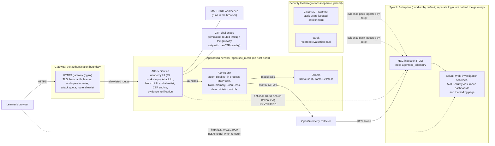
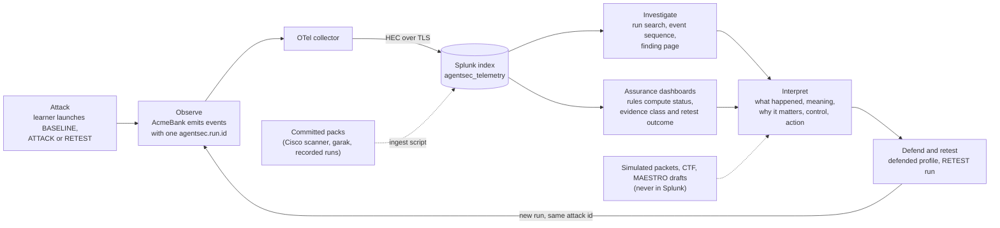
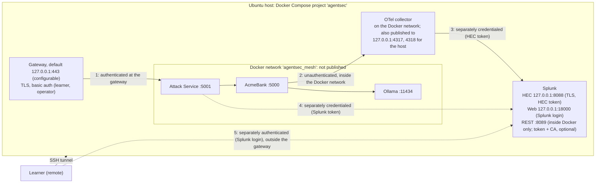
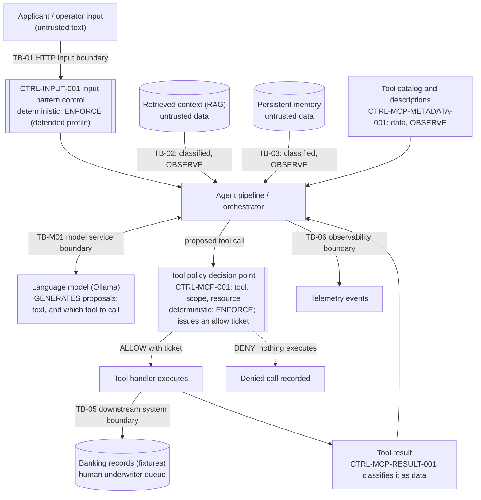
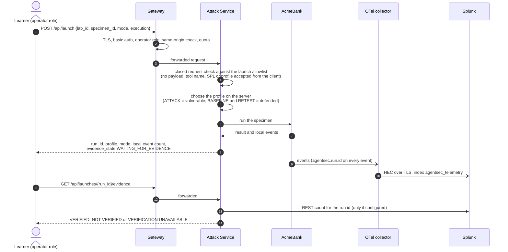
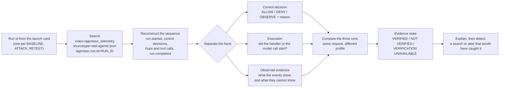
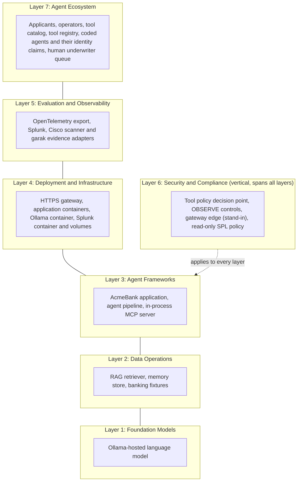
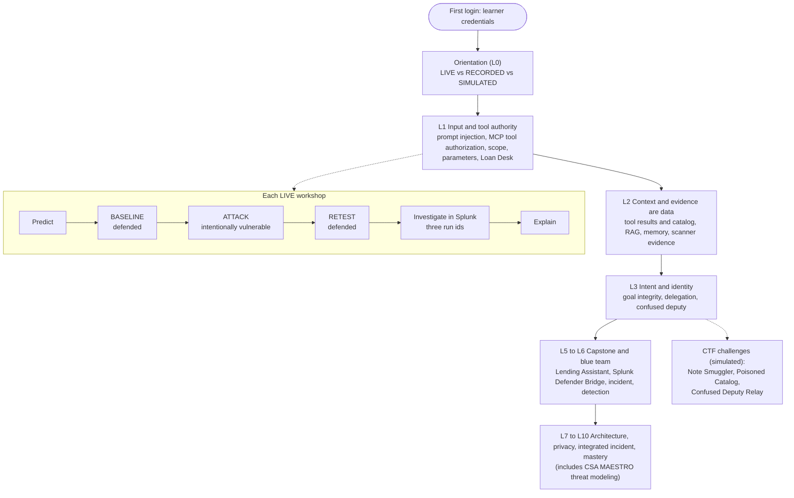
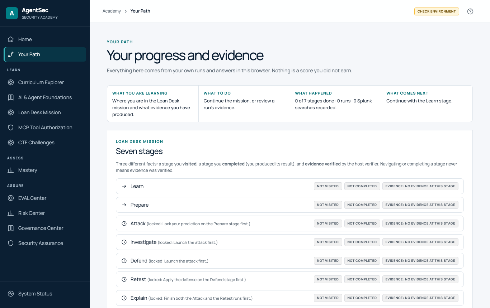

# Visual guide

Eight diagrams (1 to 3 are the overview: application architecture, data flow, trust boundaries) and the product screenshots. The diagrams are [Mermaid](https://mermaid.js.org/) and render on GitHub; each is drawn from the repository (compose files, gateway configuration, the controls in the code and the MAESTRO model), not from a design wish. Where something is optional or untested, the diagram says so.

## 1. Application architecture

The components and what each one does, as deployed by the installer in gateway mode (`docker-compose.gateway.yml`). Solid arrows are used on every run; dashed arrows are optional, run by a script, or off by default.

The language model proposes; deterministic code authorizes and executes; Splunk observes and enforces nothing. Splunk Web is **not** routed through the gateway. The scanner and garak evidence the dashboards show comes from committed packs unless you run the scanner yourself. MAESTRO runs in the browser and the CTF is a scripted simulation.

## 2. Security and telemetry data flow

From a learner's action to an explained, retested finding, and which evidence is real, recorded or simulated.

| Evidence class | Where it comes from | In Splunk and the dashboards |
|---|---|---|
| **LIVE** | A run you launched on this installation | Yes, scored |
| **RECORDED** | Committed specimens and packs captured earlier | Yes, scored, labelled recorded |
| **TEST_FIXTURE** | Synthetic negative-test runs | Only when you ask for them |
| **SIMULATED** | Simulated packets, the CTF, MAESTRO drafts | No |

A run whose telemetry never reaches Splunk cannot appear as a finding; the Academy then reports VERIFICATION UNAVAILABLE for it.

## 3. Deployment and trust boundaries

What listens where on the Ubuntu host in gateway mode (`docker-compose.gateway.yml`), and which connections are authenticated. The base `docker-compose.yml` alone (the older multi-port flow) publishes AcmeBank and the Attack Service on host ports; see the [legacy flow](LEGACY_MULTI_PORT_FLOW.md).

| Link | Authentication | Exposure |
|---|---|---|
| Browser to gateway | Basic auth, two roles, TLS | The only address to expose; loopback by default |
| Gateway to Attack Service | The gateway's decision | Inside the Docker network |
| Attack Service to AcmeBank, AcmeBank to Ollama | None (internal) | Not published on a host port |
| AcmeBank to collector | None | Docker network; the collector's host ports are loopback only |
| Collector to Splunk HEC | HEC token over TLS | Loopback only |
| Attack Service to Splunk REST | Splunk token, trusted CA | Optional, off by default |
| Browser to Splunk Web | Splunk's own login | Loopback only; **not routed through the gateway** |

**Not exposed:** AcmeBank, Ollama, the collector and HEC. The Docker bridge is not a security boundary against a hostile local user.

## 4. Agentic workflow and trust boundaries

One AcmeBank request, with the places where untrusted content enters and the two kinds of decision. **Boxes drawn with double side bars (the subroutine shape) are deterministic code.** The language model only proposes.

Three facts stay separate throughout: **what the model proposed**, **what the policy decided** (ALLOW or DENY) and **what actually executed**. An ALLOW is not an execution and a DENY is not an incident. OBSERVE controls record and classify; they do not block.

## 5. Attack execution and telemetry sequence

What happens when you press ATTACK, and where the run id and the evidence come from.

The profile is never sent by the browser: the same request produces a different outcome in ATTACK and RETEST because the server changed the profile.

## 6. Splunk investigation workflow

How a learner turns a run id into an explanation. Splunk observes; it enforces nothing.

## 7. CSA MAESTRO seven-layer architecture applied to AcmeBank

The seven layers of the Cloud Security Alliance's MAESTRO framework and where the AcmeBank elements sit in the lab's worked example. Layer 6 is vertical: it applies to every other layer. (The placement is this lab's analysis, not CSA material.)

The workbench in the Academy (`/learn/lab/LAB-THREAT-MODELING-001`, Practice tab) walks through decomposition, trust boundaries, a threat on each layer, cross-layer paths, a risk register and a downloadable report. See [Benefits and security architecture](BENEFITS_AND_SECURITY_ARCHITECTURE.md#csa-maestro).

## 8. Workshop learner journey

## Screenshots

These are captures of the real Academy and Attack Service interface. **How they were taken:** the Academy's own production bundle served by the product's Flask app on a development machine, driven by headless Chromium at 1366 by 860 pixels, **without a running AcmeBank, Ollama or Splunk behind it**, so launch cards and status panels show their "runtime not connected" state. They show the interface, not a live run. The exceptions are the last seven images: the MAESTRO example was captured through the HTTPS gateway, and the six assurance images from Splunk Web through an SSH tunnel, both on the disposable acceptance host with real data.

| Screenshot | File |
|---|---|
| Academy home |  |
| Your Path (workshop path) |  |
| A workshop page (LAB-MCP-003, Scope Escalation) |  |
| Loan Desk mission |  |
| CTF challenges |  |
| MAESTRO workbench (blank draft) |  |
| Risk Center |  |
| Attack Service home (the Attack UI) |  |
| MAESTRO workbench with the worked example loaded, through the HTTPS gateway on the acceptance host |  |
| AI Security Assurance: executive overview (Splunk Web, acceptance host) |  |
| AI Security Assurance: Agent, MCP and A2A |  |
| AI Security Assurance: supply chain and model |  |
| AI Security Assurance: threat model coverage |  |
| AI Security Assurance: compliance and governance |  |
| AI Security Assurance: one finding |  |
